# Vehicle: Skid Mark

## Overview

<h3>Overview</h3>

By default, the skid mark system is already set up on each vehicle.

Depending on the floor surface, the system instantiates a Line Renderer that represents the skid mark.

## How to modify a skid mark

### Case 1: Modify all vehicles at once

If you want to modify only one vehicle, go to [Case 2](#case-2-modify-a-specific-vehicle).

In most cases, we want to modify the trails for all vehicles at once. To do this, modify the `CarRef` prefab in the Project folder:

`Assets → Prefabs → AS → Vehicle → Prefabs → Vehicle → CarRef`

<h3>1. Open the prefab</h3>

In the Inspector, press the <strong>Open</strong> button to open the prefab.

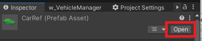

<h3>2. Find the Car Skidmark script</h3>

In the Inspector, go to the <strong>Car Skidmark</strong> script.

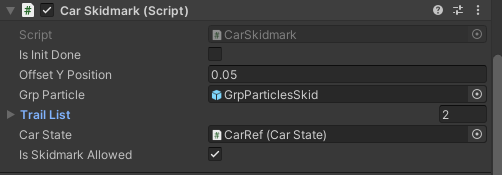

<h3>3. Open Trail List</h3>

For each surface, a trail prefab is associated.

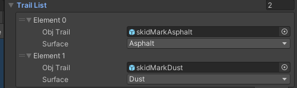

<h3>4. Select the trail prefab</h3>

To access a trail prefab, click the prefab field (marked 1).

You can modify the skid mark prefab or replace it with another one.

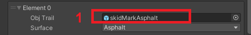

### Case 2: Modify a specific vehicle

If you want to modify only one specific vehicle, follow these steps.

<h3>1. Select your vehicle prefab</h3>

Select your prefab in the Project tab.

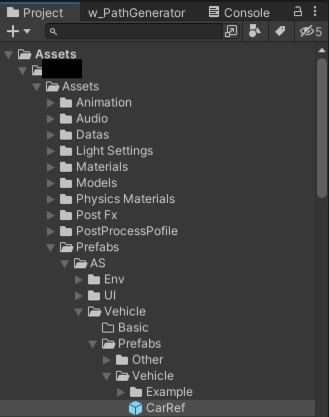

<h3>2. Open the prefab</h3>

In the Inspector, press the <strong>Open</strong> button to open the prefab.

<h3>3. Select Vehicle_sc</h3>

In the Hierarchy, select <strong>Vehicle_sc</strong>.

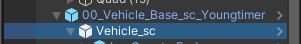

<h3>4. Find the Car Skidmark script</h3>

In the Inspector, go to the <strong>Car Skidmark</strong> script.

<h3>5. Open Trail List</h3>

For each surface, a trail prefab is associated.

<h3>6. Select the trail prefab</h3>

Click the prefab field (marked 1) to access the trail prefab. You can modify it or replace it with another one.

## How to disable the skid marks system

### Case 1: Modify all vehicles at once

If you want to modify only one vehicle, go to [Case 2](#case-2-modify-a-specific-vehicle-1).

To disable skid marks for all vehicles, modify the `CarRef` prefab in the Project folder:

`Assets → Prefabs → AS → Vehicle → Prefabs → Vehicle → CarRef`

<h3>1. Open the prefab</h3>

In the Inspector, press the <strong>Open</strong> button to open the prefab.

<h3>2. Find the Car Skidmark script</h3>

In the Inspector, go to the <strong>Car Skidmark</strong> script.

<h3>3. Disable skid marks</h3>

Uncheck <strong>Is Skidmark Allowed</strong>.

### Case 2: Modify a specific vehicle

If you want to disable skid marks for only one specific vehicle, follow these steps.

<h3>1. Select your vehicle prefab</h3>

Select your prefab in the Project tab.

<h3>2. Open the prefab</h3>

In the Inspector, press the <strong>Open</strong> button to open the prefab.

<h3>3. Select Vehicle_sc</h3>

Select <strong>Vehicle_sc</strong>.

<h3>4. Find the Car Skidmark script</h3>

In the Inspector, go to the <strong>Car Skidmark</strong> script.

<h3>5. Disable skid marks</h3>

Uncheck <strong>Is Skidmark Allowed</strong>.

## How to disable skid marks on a specific surface

### Case 1: Modify all vehicles at once

If you want to modify only one vehicle, go to [Case 2](#case-2-modify-a-specific-vehicle-2).

To disable skid marks for a surface on all vehicles, modify the `CarRef` prefab in the Project folder:

`Assets → Prefabs → AS → Vehicles → Prefabs → Vehicle → CarRef`

<h3>1. Open the prefab</h3>

In the Inspector, press the <strong>Open</strong> button to open the prefab.

<h3>2. Find the Car Skidmark script</h3>

In the Inspector, go to the <strong>Car Skidmark</strong> script.

<h3>3. Select the surface</h3>

Select the surface you want to change in the list, then click the small circle (marked 1).

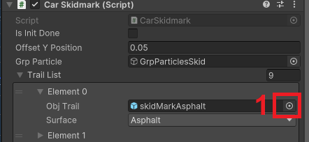

<h3>4. Choose None</h3>

A new window appears. Choose <strong>None</strong> in the list (marked 1).

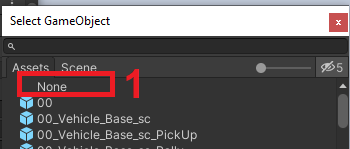

### Case 2: Modify a specific vehicle

If you want to disable skid marks on a surface for only one specific vehicle, follow these steps.

<h3>1. Select your vehicle prefab</h3>

Select your prefab in the Project tab.

<h3>2. Open the prefab</h3>

In the Inspector, press the <strong>Open</strong> button to open the prefab.

<h3>3. Select Vehicle_sc</h3>

Select <strong>Vehicle_sc</strong>.

<h3>4. Find the Car Skidmark script</h3>

In the Inspector, go to the <strong>Car Skidmark</strong> script.

<h3>5. Select the surface</h3>

Select the surface you want to change in the list, then click the small circle (marked 1).

<h3>6. Choose None</h3>

A new window appears. Choose <strong>None</strong> in the list (marked 1).

## How to change the skid mark texture

<h3>1. Open the Skidmarks materials folder</h3>

In the Project tab, go to:

<code>Assets → Materials → Vehicle → Skidmarks</code>

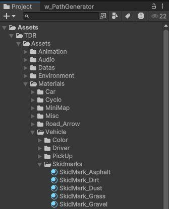

<h3>2. Select the material</h3>

Select the material you want to change. For example, select <strong>Skidmark_Ice</strong>.

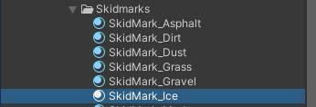

<h3>3. Replace the texture</h3>

In the Inspector, replace the texture with a new one (marked 1).

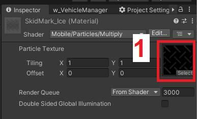

<h3>Tip</h3>

You can use the <strong>Skidmark02</strong> texture as a reference for your new texture.

<code>Assets → Textures → Vehicle → Skidmark02</code>

